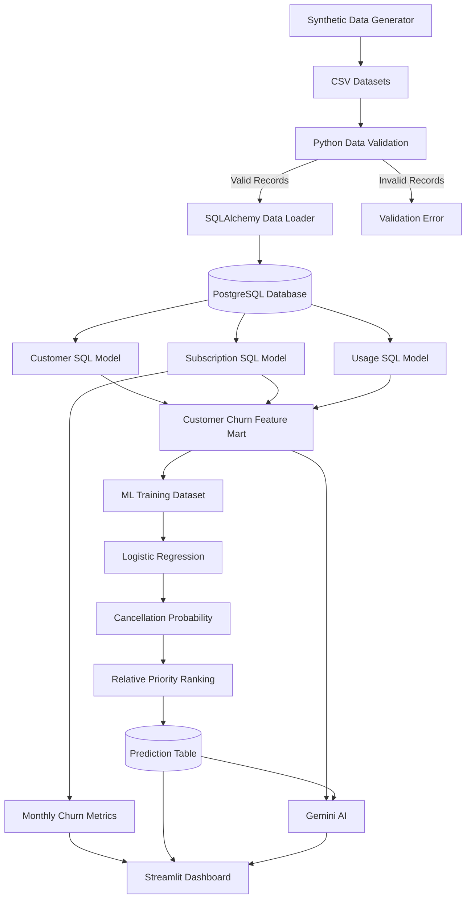

# 📊 Subscription Churn Mart V3


An end-to-end **Analytics Engineering and Machine Learning** project that processes synthetic customer subscription data, builds SQL transformation models, analyzes historical churn, estimates next-month cancellation probabilities, and explains customer risk using Google Gemini AI.

The project integrates **Python, PostgreSQL, SQLAlchemy, Logistic Regression, Gemini AI and Streamlit**.

> **Data Source:** Synthetic customer, subscription and usage records.

> **Important:** Machine-learning probabilities are trained on synthetic data and are not validated for real-world customer behavior.

---

## 📑 Table of Contents

- [Problem Statement](#problem-statement)
- [Key Features](#key-features)
- [System Architecture](#system-architecture)
- [Technology Stack](#technology-stack)
- [Repository Structure](#repository-structure)
- [Dataset](#dataset)
- [SQL Transformations](#sql-transformations)
- [Churn Calculation](#churn-calculation)
- [Machine Learning](#machine-learning)
- [Customer Risk Prioritization](#customer-risk-prioritization)
- [Gemini AI Integration](#gemini-ai-integration)
- [Getting Started](#getting-started)
- [Running the Project](#running-the-project)
- [Dashboard](#dashboard)
- [Data Quality and Validation](#data-quality-and-validation)
- [Testing](#testing)
- [Design Decisions](#design-decisions)
- [Limitations](#limitations)
- [Future Improvements](#future-improvements)
- [Security](#security)
- [Demo Video](#demo-video)

---

## 🎯 Problem Statement

Subscription-based businesses frequently lose customers due to declining engagement, payment difficulties, changing preferences and other factors.

Identifying potential cancellations before the next subscription period can help businesses prioritize customer-retention efforts.

However, customer information is distributed across multiple sources:

- Customer information
- Subscription plans
- Monthly usage activity
- Payment failures
- Cancellation history

This project transforms these records into a unified analytical customer dataset.

The main objectives are:

1. Calculate historical monthly customer churn.
2. Monitor changes in customer engagement.
3. Build reusable SQL analytical features.
4. Estimate next-month cancellation probabilities.
5. Rank customers for retention review.
6. Explain predictions using Google Gemini AI.
7. Display business metrics through an interactive dashboard.

---

## 🚀 Key Features

- **Synthetic data generation:** Generates 10,000 customer records and historical monthly activity.
- **PostgreSQL storage:** Stores relational customer and subscription data.
- **SQL transformations:** Uses joins, aggregations, date calculations and analytical features.
- **Historical churn analytics:** Calculates monthly churn and retention.
- **Feature engineering:** Calculates usage decline, three-month average usage, sessions and customer tenure.
- **Machine learning:** Uses Logistic Regression to estimate next-month cancellation probability.
- **Chronological evaluation:** Separates historical training, validation and testing periods.
- **Customer prioritization:** Assigns HIGH, MEDIUM and LOW relative review priorities.
- **Gemini AI explanations:** Explains SQL-engineered features and ML results.
- **Fallback explanations:** Provides rule-based explanations if Gemini is unavailable.
- **Streamlit dashboard:** Displays churn metrics, predictions and customer-level details.
- **Automated testing:** Includes tests for source validation, ML logic and explanations.

---

## 🏗️ System Architecture

The project follows a layered analytics and prediction architecture.



### Architecture Components

| Component | Responsibility |
|---|---|
| Synthetic Generator | Creates reproducible customer activity |
| Python Validation | Detects invalid and duplicate records |
| SQLAlchemy | Connects Python to PostgreSQL and loads records |
| PostgreSQL | Stores source data and saved predictions |
| SQL Transformation Models | Create customer-level analytical features |
| Churn Mart | Provides structured inputs to the ML model |
| Logistic Regression | Estimates cancellation probability |
| Priority Ranking | Ranks active customers by predicted risk |
| Gemini AI | Explains analytical features and predictions |
| Streamlit | Displays business analytics and explanations |

---

## 🛠️ Technology Stack

| Layer | Technology | Purpose |
|---|---|---|
| Programming | Python | Data processing and application logic |
| Database | PostgreSQL | Relational storage and analytics |
| Database Integration | SQLAlchemy + psycopg | Connections and transactions |
| Data Processing | Pandas and NumPy | ML input preparation |
| Transformations | PostgreSQL SQL | Joins, calculations and analytical views |
| Machine Learning | Scikit-learn | Logistic Regression |
| Model Storage | Joblib | Save trained ML models |
| AI Integration | Google Gemini | Natural-language explanations |
| Dashboard | Streamlit | Interactive analytics |
| Testing | Pytest | Automated validation |
| Version Control | Git and GitHub | Repository management |

---

## 📁 Repository Structure

```text
Subscription-Churn-Mart/
│
├── app/
│   ├── __init__.py
│   ├── config.py
│   ├── database.py
│   ├── generate_data.py
│   ├── validation.py
│   ├── pipeline.py
│   ├── ml_model.py
│   ├── explanations.py
│   ├── dashboard.py
│   └── test_gemini.py
│
├── sql/
│   ├── 01_schema.sql
│   ├── 02_customer_model.sql
│   ├── 03_subscription_model.sql
│   ├── 04_usage_model.sql
│   ├── 05_churn_mart.sql
│   └── 06_monthly_metrics.sql
│
├── data/
│   ├── customers.csv
│   ├── subscriptions.csv
│   ├── subscription_monthly.csv
│   └── monthly_usage.csv
│
├── models/
│   ├── churn_model.joblib
│   └── metrics.json
│
├── tests/
│   ├── test_validation.py
│   ├── test_ml.py
│   └── test_explanations.py
│
├── docs/
│   ├── architecture.md
│   └── design_note.md
│
├── .env.example
├── .gitignore
├── requirements.txt
└── README.md
```

The CSV files and model artifacts are generated when the pipeline runs and do not need to be committed.

---

## 📊 Dataset

The project uses synthetic subscription customer data.

### Dataset Summary

| Dataset | Records |
|---|---:|
| Customers | 10,000 |
| Subscriptions | 10,000 |
| Subscription-month history | 150,039 |
| Monthly usage observations | 148,511 |
| Historical reporting period | April 2025 – September 2026 |
| Reporting months | 18 |

These are sample results from the current dataset configuration.

### Main Tables

**customers**

Contains customer identifiers, names and joining dates.

**subscriptions**

Contains subscription plans and monthly prices.

**subscription_monthly**

Contains monthly active status, cancellations and payment failures.

**monthly_usage**

Contains customer activity hours and monthly session counts.

**customer_risk_predictions**

Stores the model's estimated cancellation probability and relative priority.

---

## 🔄 SQL Transformations

SQL transformations convert raw database records into meaningful features for analytics and Machine Learning.

The project implements four main analytical models.

### 1. Customer Model

File: `sql/02_customer_model.sql`

Creates the `stg_customers` view containing customer attributes.

### 2. Subscription Model

File: `sql/03_subscription_model.sql`

Creates `stg_subscriptions`, combining subscription information with monthly status and payment activity.

### 3. Usage Model

File: `sql/04_usage_model.sql`

Calculates:

- Current-month usage hours
- Previous-month usage hours
- Usage decline percentage
- Three-month average usage
- Current-month sessions
- Missing-data status

**Usage decline formula:**

\[
\text{Usage Decline}
=
\frac{\text{Previous Usage}-\text{Current Usage}}
{\text{Previous Usage}}\times100
\]

For example, usage falling from 80 hours to 20 hours gives a 75% decline.

A negative decline value represents increased usage.

The transformation handles missing data and division by zero.

### 4. Customer Churn Mart

File: `sql/05_churn_mart.sql`

Creates `customer_churn_mart`, combining customer, subscription and engagement features.

It also constructs supervised learning labels from the following month's subscription status.

The final feature mart contains customer-month observations rather than a single record per customer.

### 5. Monthly Metrics Model

File: `sql/06_monthly_metrics.sql`

Calculates monthly churn, retention and revenue loss.

---

## 📈 Churn Calculation

Historical churn is calculated using subscription cancellations.

\[
\text{Monthly Churn Rate}
=
\frac{\text{Customers Cancelled During Month}}
{\text{Customers Active at Start of Month}}
\times100
\]

Example:

- Customers at month start: 8,000
- Customers cancelled: 240

\[
\text{Churn Rate} = 3\%
\]

Other calculated metrics include:

- Customers active at the beginning of the month
- Customers cancelled during the month
- Customers active at the end of the month
- Monthly retention rate
- Lost monthly recurring revenue

These metrics are computed using SQL rather than Gemini.

---

## 🧠 Machine Learning

### Objective

Estimate whether an active customer will cancel their subscription in the next calendar month.

### Algorithm

**Logistic Regression**

Implemented using Scikit-learn.

### Input Features

The model uses SQL-engineered features:

| Feature | Description |
|---|---|
| `monthly_price` | Subscription price |
| `payment_failures` | Monthly failed payments |
| `current_month_hours` | Current usage |
| `current_month_sessions` | Current engagement |
| `previous_month_hours` | Previous monthly usage |
| `usage_decline_percent` | Monthly usage change |
| `avg_usage_3_months` | Three-month average activity |
| `tenure_months` | Customer tenure |
| `plan_name` | Subscription plan |
| `usage_data_status` | Data completeness indicator |

### Target Variable

`churn_next_month`

- `1`: Customer cancelled during the following month.
- `0`: Customer did not cancel during the following month.

Only records with observed future outcomes are used for supervised model training.

### Model Pipeline

1. Load SQL-engineered features.
2. Handle missing values.
3. Encode categorical features.
4. Scale numeric features.
5. Split historical data chronologically.
6. Train Logistic Regression.
7. Evaluate the model.
8. Generate latest-month predictions.
9. Save predictions to PostgreSQL.

### Evaluation Metrics

The implementation calculates:

- ROC-AUC
- PR-AUC
- Precision
- Recall
- Brier Score

Actual metric values are generated by:

```powershell
python -m app.ml_model
```

The evaluation output is also saved in `models/metrics.json`.

> The dataset is synthetic. Model performance demonstrates the analytical workflow and should not be presented as validated real-world predictive accuracy.

---

## 🎯 Customer Risk Prioritization

The ML model generates an estimated next-month cancellation probability.

A separate ranking policy assigns relative customer-review priorities.

| Priority | Ranking Rule |
|---|---|
| HIGH | Top 10% by cancellation probability |
| MEDIUM | Next 20% |
| LOW | Remaining 70% |

### Example

A customer with a predicted cancellation probability of 7.21% may receive HIGH priority if their probability is among the highest 10% of the active customer population.

**HIGH priority does not mean the customer has an 80% or 90% cancellation probability.**

The dashboard separately displays the model's estimated probability and the customer's review priority.

---

## 🤖 Gemini AI Integration

Google Gemini generates customer-risk explanations using the already-engineered SQL features and stored ML prediction results.

Gemini does not:

- Calculate historical churn rates.
- Train the ML model.
- Assign cancellation probabilities.
- Change stored customer-review priorities.

### Explanation Input

The application allows Gemini to receive approved analytical fields including usage, payment activity, subscription plan, model probability and relative priority.

Customer names and email addresses are excluded from the explanation feature payload.

### Fallback Handling

If Gemini cannot be reached, the API key is unavailable, or the generated response is incomplete, a deterministic rule-based explanation is displayed.

The dashboard identifies whether the displayed explanation came from Gemini or the fallback.

---

## ⚙️ Getting Started

### Prerequisites

Install:

- Python 3.11 or newer with compatible dependencies
- PostgreSQL
- Git
- VS Code (optional)
- pgAdmin 4 (optional)

A Gemini API key is required for live Gemini-generated explanations.

### 1. Clone Repository

```powershell
git clone https://github.com/YOUR_USERNAME/Subscription-Churn-Mart.git
cd Subscription-Churn-Mart
```

Replace `YOUR_USERNAME` with your GitHub username.

### 2. Create Virtual Environment

Windows PowerShell:

```powershell
python -m venv .venv
.\.venv\Scripts\Activate.ps1
```

### 3. Install Requirements

```powershell
python -m pip install -r requirements.txt
```

### 4. Configure Environment

Copy:

```powershell
Copy-Item .env.example .env
```

Update `.env`:

```dotenv
DB_HOST=localhost
DB_PORT=5432
DB_NAME=subscription_churn_db_v3
DB_USER=postgres
DB_PASSWORD=your_postgresql_password

GEMINI_API_KEY=your_gemini_api_key
GEMINI_MODEL=gemini-2.5-flash

CUSTOMER_COUNT=10000
```

Never commit `.env`.

### 5. Create PostgreSQL Database

Using pgAdmin Query Tool connected to the default `postgres` database:

```sql
CREATE DATABASE subscription_churn_db_v3;
```

Create it only if it does not already exist.

The Python pipeline creates tables and analytical views.

---

## ▶️ Running the Project

Run the commands from the project root.

### Step 1: SQL Data Pipeline

```powershell
python -m app.pipeline
```

This generates data, validates records, loads PostgreSQL and creates the SQL transformation views.

### Step 2: Train Machine Learning Model

```powershell
python -m app.ml_model
```

This trains and evaluates Logistic Regression, then updates saved customer predictions.

### Step 3: Run Automated Tests

```powershell
python -m pytest tests/ -v
```

### Step 4: Launch Dashboard

```powershell
python -m streamlit run app/dashboard.py
```

Open the local Streamlit address shown in the terminal, usually:

`http://localhost:8501`

---

## 🖥️ Dashboard

The Streamlit dashboard presents:

### Historical Analytics

- Monthly churn rate
- Monthly cancellation count
- Customer retention rate
- Lost monthly recurring revenue
- Historical trend charts

### ML Predictions

- Number of scored active customers
- HIGH-priority customers
- MEDIUM-priority customers
- LOW-priority customers
- Estimated cancellation probability
- Filterable customer prediction table

### Gemini Explanations

Users can select a customer to view:

- SQL-engineered customer features
- Estimated next-month cancellation probability
- Relative review priority
- AI-generated or rule-based explanation

---

## 🛡️ Data Quality and Validation

The pipeline validates source data before loading records.

| Validation | Handling |
|---|---|
| Duplicate customer identifiers | Reject |
| Duplicate subscription records | Reject |
| Duplicate customer-month records | Reject |
| Invalid subscription plans | Reject |
| Negative usage hours | Reject |
| Invalid payment failures | Reject |
| Unknown customer references | Reject |
| Inconsistent cancellation states | Reject |
| Subscription history after cancellation | Reject |
| Missing monthly usage | Preserve as missing evidence |

Invalid data produces validation errors rather than being silently accepted.

The current implementation does not include a quarantine-file pipeline.

### Database Consistency Check

```sql
SELECT
    month_start,
    customers_at_start,
    churned_customers,
    customers_at_end,
    customers_at_start
      - churned_customers
      - customers_at_end
      AS reconciliation_difference
FROM monthly_churn_metrics
ORDER BY month_start;
```

Expected reconciliation difference: `0` for every reporting month.

---

## 🧪 Testing

The project uses Pytest for automated testing.

Run:

```powershell
python -m pytest tests/ -v
```

Tests cover:

- Valid source data
- Duplicate customer rejection
- Negative usage rejection
- Invalid cancellation status
- Unknown customer references
- ML model training behavior
- Chronological splitting
- Relative priority assignment
- Invalid predicted probabilities
- Restricting sensitive fields from Gemini input
- Rule-based explanation behavior
- Explanation-format validation, where included

A failure or edge-case demonstration should be included in the assessment video.

Report the actual final test results after running the suite.

---

## 🧩 Design Decisions

### SQL as the Analytical Foundation

Customer metrics and engineered features are calculated in PostgreSQL through reusable SQL views.

### SQLAlchemy for Database Connectivity

SQLAlchemy handles Python-to-PostgreSQL connections and transactions while retaining raw SQL for analytical transformations.

### Logistic Regression Baseline

Logistic Regression provides a relatively simple and explainable baseline for cancellation prediction.

### Chronological Data Split

Historical months are used for training, while later months are reserved for evaluation.

### Separate Prediction and Explanation

ML calculates probabilities. Gemini generates narratives from already-calculated evidence.

### Relative Customer Prioritization

Customers are ranked using predicted probabilities so that review priorities remain distinguishable from absolute risk estimates.

---

## ⚠️ Limitations

- Uses synthetic customer behavior.
- Model probabilities are not validated against real customer outcomes.
- Cancellation relationships are influenced by the synthetic generator.
- The model has not undergone comprehensive probability calibration.
- Relative priority bands are operational ranking rules.
- The system processes historical monthly snapshots rather than live events.
- The loader uses upserts rather than a full incremental change-data-capture pipeline.
- The simplified subscription model does not handle complex reactivation or multiple simultaneous subscriptions.
- Gemini output validation does not independently verify every factual statement.
- The pipeline currently uses in-memory data generation and batch loading.

---

## 🔮 Future Improvements

- Add historical real-world labeled data with appropriate permissions.
- Introduce probability calibration.
- Compare Random Forest and gradient-boosting models with Logistic Regression.
- Add model drift and data freshness monitoring.
- Implement incremental ingestion and updates.
- Support renewal-date-aware prediction snapshots.
- Add model explainability using coefficients or SHAP.
- Support streaming event ingestion.
- Add PostgreSQL integration tests and CI/CD.
- Containerize the project with Docker.
- Add stronger Gemini response grounding checks.

---

## 🔐 Security

- Store credentials in `.env`.
- Exclude `.env` through `.gitignore`.
- Commit `.env.example` with placeholders.
- Never expose API keys or database passwords.
- Use synthetic data for demonstrations.
- Rotate accidentally exposed credentials.
- Never load untrusted model artifact files using Joblib.

---

## 📚 Documentation

- [System Architecture](docs/architecture.md)
- [Design Note](docs/design_note.md)
- [Database Schema](sql/01_schema.sql)
- [Customer SQL Model](sql/02_customer_model.sql)
- [Subscription SQL Model](sql/03_subscription_model.sql)
- [Usage SQL Model](sql/04_usage_model.sql)
- [Customer Churn Mart](sql/05_churn_mart.sql)
- [Monthly Churn Metrics](sql/06_monthly_metrics.sql)

---

## 🎥 Demo Video

**5–8 minute technical assessment demo:** Add the accessible video link here.

The video should demonstrate the architecture, SQL transformations, ML results, Gemini explanation, tests and an edge case.

---

## 📌 Conclusion

Subscription Churn Mart V3 demonstrates an end-to-end analytics engineering workflow combining relational data modeling, SQL feature engineering, historical churn analysis, Machine Learning and AI-assisted explanations.

The project prioritizes reproducibility, separation of responsibilities, transparent risk interpretation and meaningful validation.

Built as a Data & AI technical assessment project using synthetic data.
