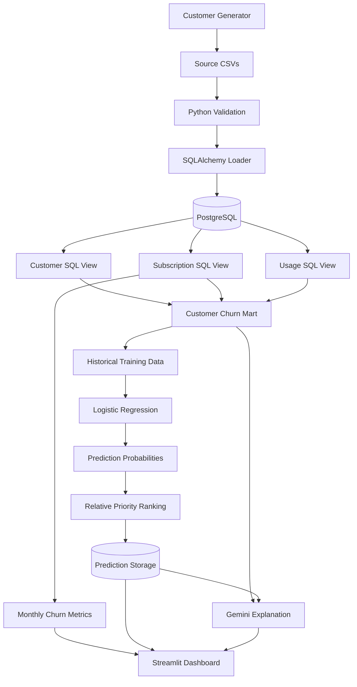

# Subscription Churn Mart — System Architecture

## Objective

Build a reproducible analytics engineering system
for historical subscription churn analysis and
next-month customer cancellation-risk estimation.

## Architecture Diagram

## Data Layers

### Source Layer

Synthetic customer, subscription, monthly status
and usage records.

### Validation Layer

Checks uniqueness, numeric constraints, references
and subscription-status consistency.

### Storage Layer

PostgreSQL relational tables with primary keys,
foreign keys and data constraints.

### Transformation Layer

SQL views calculate customer-level features and
monthly business metrics.

### Machine Learning Layer

Logistic Regression uses engineered historical
features to estimate next-month cancellation.

### Explanation Layer

Gemini receives approved engineered features
and existing ML results.

### Presentation Layer

Streamlit presents churn trends, saved predictions,
relative review priorities and explanations.

## Model Timing

Features for a completed reporting month are used
to estimate cancellations during the following month.

Future outcomes are used as training targets,
not model inputs.

## Data Quality

The pipeline rejects invalid source data and
checks historical customer count reconciliation.

## Important Limitations

- Synthetic data
- No real-time ingestion
- No calibrated real-world probability guarantees
- No complex subscription reactivation model
- No production-scale streaming infrastructure
